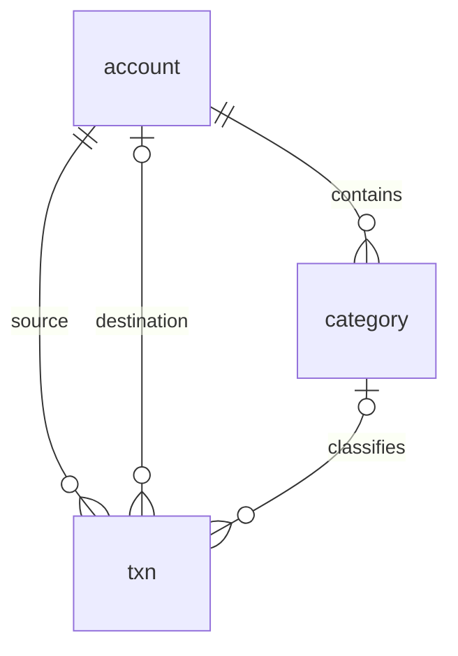

# Architecture and Code Guide

See the [documentation entry point](README.md) for confirmed product boundaries and [OPERATIONS.md](OPERATIONS.md) for runtime maintenance. Agent-config's `server-operations` maintains the shared server design; this project does not duplicate global configuration.

## How Requests Flow

The browser first requests a page address. Go returns the embedded `index.html` and hashed JS/CSS. Vue Router mounts `/transactions` as the persistent workbench; `manage`, `add`, `batch`, and `txn/:id/edit` are child routes rendered in the side panel. The root path opens “明细”. Old `/overview`, `/search`, `/reports`, `/accounts`, and entry links redirect to the corresponding workbench view or panel while preserving applicable parameters; old search links default to all time. Go distinguishes only APIs, static resources, and page entry points; it does not render Vue page by page in the backend.

`router/lazyPage.ts` uses a synchronous route container for asynchronous page modules, so navigation completes and the title and selected item change immediately. `PageSkeleton` displays a placeholder while the module downloads and offers a reload action if the download fails. Skeletons cover metadata, initial results, and filter updates; failure exits the loading state and offers retry. The workbench keeps its background and filters mounted, and rereads data after a panel closes.

Workbench scrolling occurs in `.work-area`. Before `loading` changes from false to true and before the DOM updates, `Workspace` measures the old results container and immediately sets `min-height` to preserve its space. Removing the focused control after a pagination click triggers layout calculation, so the placeholder must be established before Vue replaces child nodes; waiting only for a parent style binding to update is insufficient. The style binding releases the height together with new content after loading. Consecutive switches share one preserved height, and stale requests cannot end loading early. `.work-area` disables browser scroll anchoring and retains the numeric scroll position when view content changes rather than anchoring to a result row. Page, page-size, view, and month changes do not call `scrollTo` or force the old position back after completion, so the user can still scroll while waiting. If new content is too short, the browser contracts to the natural boundary without permanent blank fill. Regression checks inspect actual pagination clicks, page-size changes, last-page boundaries, view/month switches, slow requests, rapid consecutive operations, and reduced-motion behavior frame by frame on desktop and a 375px phone.

The multi-application build sets `BASE_PATH=/ledger/`. Vue assets, routes, and APIs share this prefix. Shared Nginx accepts `/ledger/`, strips the prefix, and proxies to the Go service listening only on `127.0.0.1:18080`; other paths do not reach Ledger. It preserves `Host`, so same-origin validation still works behind the proxy.

Vue pages call explicit functions in `api/index.ts`. `client.ts` performs one `fetch` and parses errors; it does not automatically retry writes. HTTP handlers decode fixed JSON types and then call methods in the `ledger` package; only that package touches SQL. There is no repository-interface layer, ORM, event bus, or local ledger.

SQLite uses WAL, foreign keys, and one connection. Multi-step saves use transactions, while ordinary queries execute SQL directly. The count, current page, and daily subtotals for `transactions/query` are read in the same transaction. Statistics requested through separate interfaces may require refresh after another window writes, which is appropriate for the single-person use case.

## Pages and Shared Components

Phone viewports use the browser's default safe-area layout and do not enable `viewport-fit=cover`. The top bar sits outside the `.work-area` scroll container and explicitly uses `position: sticky; top: 0` with an opaque background: a visually persistent `relative` layout is not a sticky element to WebKit. Top-bar dimensions and body-internal scrolling remain unchanged. See the [top safe-area note](https://github.com/Crashmere/agent-config/blob/main/skills/server-operations/references/common-issues.md#iphone-主屏幕页面顶部发虚) for comparisons with other applications and the boundary of iPhone home-screen validation.

| Component | Content and primary interactions |
| --- | --- |
| Workspace.vue | Account scope, balances, date/search/filter controls, summaries, paginated details, detail view, and temporary exclusion; nested management panel, focus, offline reconnection, and route state |
| RangeSelect.vue | Single-choice time-range menu, anchor positioning, keyboard browsing and confirmation, and arrow/menu transitions |
| InsightView.vue | Income/expense trends for the same scope (aggregated by day/month/year), category proportion and ranking, annualized spending, and monthly daily-expense calendars; category drill-down returns to “明细” |
| InsightTransactions.vue | Interval income/expense popover beside the selected chart point; retains workbench filters, reads pages in descending amount order, and shows only title and amount |
| Accounts.vue | Account/category management panel; initial balance, include-in-total switch, color, normal/project kind, period, archive state, CRUD, drag/button sorting, and transaction viewing after selecting an account |
| AddTxn.vue / BatchImport.vue | Single-transaction create/edit/copy/delete and desktop calculator; text parsing, per-line edits, batch changes, validation, and atomic save; `EntryTabs` retains account context |

`App.vue` mounts only `RouterView` and `ToastHost`. `Workspace` owns application layout and the side panel. `tokens.css` defines colors and controls, while `base.css` defines the workbench, compact transaction columns, side panel, and responsive layout. The desktop workbench is centered with a 1240px maximum width, and the side panel aligns with the workbench's right edge so content is not dispersed across a large screen. On phones the account scope moves into the top bar, transaction rows combine auxiliary columns, and the side panel becomes full-screen. The background is `inert`; the panel supports Escape, focus constraints, and focus restoration after close. Native `ModalDialog` manages confirmation/entity-edit dialogs other than details and cannot close while busy. Save state continues to use `SaveStatus`. Transaction-row icons, category tags, and detail-category indicators use the saved color by category ID, including same-name categories under different accounts; amounts still use income/expense/transfer colors, while uncategorized entries and transfers use default styling.

The visual system uses a warm-white background, dark-green primary color, light borders, and restrained shadows. The desktop account rail's balance card, four summary cards, and transaction-content container form the hierarchy. Below 850px it uses a top total card; below 600px, income and expenses sit side by side, net amount occupies its own row, and the annualized card is hidden. Trend charts and amounts consistently use income green and expense terracotta; category statistics retain the chart palette. Single-entry amount backgrounds follow transaction type, and the save bar sticks to the bottom of the panel. Management, batch entry, and details share control and corner-radius rules.

At 600px and below, the top bar hides direct management, batch-entry, and “记一笔” buttons. A lightly bordered ledger selector sits on the right beside the three-line `WorkspaceMenu` button. “账户管理” is inside the dropdown, and batch entry is reached through `EntryTabs` after opening the floating “记一笔” action. The menu uses a lightweight open/close transition and closes on an outside click, Escape, route change, or breakpoint change. Tab and arrow keys close the menu before continuing workbench shortcuts. Before opening the management panel, focus returns to the menu button; closing the panel restores focus to that button. Menu listeners are removed when the component unmounts. The desktop retains its existing action bar.

The site mark uses a dark-green gradient background, a warm-white L-shaped ledger page, and two short ledger lines, one pale gold. `web/public/favicon.svg` is the graphic source and the workbench's upper-left corner reuses the same SVG; functional in-page icons still use `AppIcon`. The browser receives both SVG and 32px PNG icons, iOS uses a full-background 180px icon, and the manifest supplies 192/512px ordinary icons plus a 512px maskable icon. The system crops full-background versions, with the mark inside the maskable safe circle to avoid double-rounded corners or clipping. All icons are local assets, and their URLs include a graphic-version parameter to refresh old favicon caches.

Animations use CSS and Vue `Transition` without another animation dependency: button press, sliding tab indicator, view fade, filter-height expansion, panel/backdrop open and close, and native-dialog entry. Animations are approximately 160–320ms; amounts display server results directly without rolling numbers. “明细”/“洞察” retain their tab/tabpanel relationships and active view state, and switching preserves the same filters. Pointer events are disabled while a panel exits; existing save and leave guards still determine whether navigation is allowed. Every animation follows `prefers-reduced-motion`, and read/save states remain understandable without animation. Global focus outlines and the focus border/glow on search, amount, and other inputs are removed without changing the state colors for the current view, active filters, or transaction type.

`Workspace` handles main-page shortcuts in the capture phase. Tab / Shift+Tab switch “明细” and “洞察” and release current focus rather than traversing controls. Left/Right call month switching only for the monthly range; other ranges do not change dates or chart selection. Inputs and editable text retain native cursor behavior, and modifier combinations and IME composition are not intercepted. Background shortcuts do not run while a panel, native dialog, or offline screen is open. `MonthSwitch` handles only month buttons and labels. `Workspace` reads month bounds during initialization and return refresh; `MonthSwitch` no longer listens separately for arrow keys, window focus, or route changes. In the capture phase, `AddTxn` constrains Tab to an amount/title/note cycle, with Shift+Tab reversing it. Desktop amount entry uses the calculator area, while phones use native amount input. If no fields exist during loading, focus does not move to another control. Dialog and save-wait focus is delegated to the modal; management and batch panels keep their existing focus constraints. `AddTxn` focuses amount after a new or copied form loads (`Workspace` focuses the close button on panel open only if focus is not already within the panel). Panel Escape closing and Tab constraints ignore IME key events: Chrome/Firefox dispatch during composition with `isComposing=true`, while Safari dispatches the composition-ending key after `compositionend`, identifiable only through keyCode 229. During composition, Esc cancels composition only; otherwise one Escape closes the panel.

Scripts create and clean up synthetic temporary databases and use local ports 19190/19191 to verify business flows, filtering, focus restoration, normal/reduced-motion modes, and pages and dialogs at 320/375/768/1440px. Screenshots are stored in ignored `var/ui-verification`; the scripts do not access the production ledger.

`RangeSelect` replaces the native time-range `select` with combobox/listbox semantics while retaining the `month`/`30d`/`year`/`all`/`custom` query values. The button has fixed width and 12px of right padding for the arrow. The menu is teleported to `body`, uses the button as the anchor for `fixed` positioning, stays within left/right viewport bounds, flips vertically, and scrolls within a height limit without participating in workbench layout. Focus remains on the button and `aria-activedescendant` identifies the currently browsed option; the range is submitted only on confirmation. Esc/Tab cancel and return to the button, while `Workspace` suspends background shortcuts while open. Outside clicks, anchor scroll, window-size changes, and route changes close the menu; late scroll events that occurred before the click are ignored, while internal list scrolling does not close it. Listeners are cleaned up when the component unmounts. Menu scale/fade, arrow rotation, option state, and label transition all follow reduced motion. Browser regressions cover all five ranges, filter preservation, keyboard confirm/cancel, stable page position, 320/375px edges, low-height windows, and reduced motion.

`FilterPanel` provides multi-select type/account/category filters, category exclusion, removable condition tags, and amount validation. Category left-click toggles inclusion; right-click toggles exclusion and suppresses the browser context menu. Each name has one state, and exclusion uses a terracotta crossed-out choice and an explicit removable tag. `Workspace` maps selected and excluded names to all matching category IDs across accounts; `excludedCategoryIds` enters the same backend `buildFilter` used by details, full-day subtotals, and every statistic. The exclusion predicate preserves NULL category IDs so uncategorized entries and transfers remain eligible.

`Workspace` builds the single query state, and route changes can restore conditions in reverse. The `categories` and `excludedCategories` query values store included and excluded names as JSON arrays. The toolbar's icon reset button and the panel's `reset` event share `Workspace.resetFilters`, clearing account, type, included/excluded category, and amount in one operation, synchronizing the URL through existing watchers, returning to page one, and coalescing queries. Date, search, temporary exclusions, sorting, and view remain unchanged. When the panel is mounted, its `resetDraft` is called synchronously to clear unapplied amount input and error messages; the collapsed panel does not need to mount before reset. The header condition row and tags share a 30px minimum height so the filter fields do not move between the empty prompt and one-line conditions. Multiple conditions and long names wrap naturally without limiting container height.

`InsightView` uses backend daily data, while `services/insightData.ts` groups it only for display: at most 62 days remain daily bars, 63–730 days sum by month, and longer ranges sum by year. Every amount stays in integer cents, and partial months/years show actual start and end dates. Hovering a trend interval shows its amount; selecting it opens the income/expense detail popover. The list does not request daily chart data. An all-time chart first queries the earliest/latest transaction dates; above 3661 days it asks the user to narrow the chart range while summaries, categories, and details still use the full filter. A chart-read failure does not clear ledger entries.

`InsightTransactions` receives the actual start/end dates and click coordinates for a chart block. Through `services/insightTransactions.ts`, it intersects those dates with `Workspace`'s `TransactionFilter`. Account, category, type, amount, keyword, temporary exclusion, and project scope are all retained. Only `income`/`expense` are queried because transfers are not chart income/expenses. If only transfers are selected or the date intersection is empty, it displays no income/expenses directly, preventing an empty `types` array from becoming unrestricted in the API. It reuses `transactions/query` with 30 entries per page and `sortBy=amount`/`sortDir=desc`; income and expenses are interleaved by integer-cent amount, and “加载更多” reads later pages. An empty title displays “未命名交易”; notes and accounts are not shown. Request sequence numbers discard stale results after switching/unmounting. Failure retains already loaded records and permits retry. Reads affect only the popover and do not change `Workspace` loading or the route.

The popover is teleported to `body`, uses fixed coordinates, and remeasures through `ResizeObserver` after loading. When space is insufficient, it flips to the other side of the selected point and remains inside the viewport. The internal list scrolls within a height limit while the main chart and page scroll position remain unchanged. It closes on an outside click, Escape, external scroll, window resize, route change, filter change, chart-data change, or calendar-year change. Internal scrolling does not close it, and the main page's Tab/arrow-key rules still apply. It records the scroll position at opening and ignores late events for scrolling that occurred before the click, preventing immediate accidental close. Listeners and observers are removed on unmount. Entry fade and local loading animation follow reduced motion.

The category-statistics interface returns income and expenses for every category in one response. `InsightView` switches direction by filtering, sorting, and displaying locally; it does not trigger `Workspace` filter watchers, a full-page load, or another request. Only the category area shows a 220ms cross-fade and thin progress bar. Both variants occupy the same grid position and use the taller height so differing category counts do not move the calendar or scroll position. Hidden content receives `aria-hidden` and `inert`; category drill-down is temporarily unavailable during transition, while the income/expense switch remains usable. The last choice wins during rapid clicks, and timers are cleaned up on unmount. Reduced-motion mode switches immediately. Category drill-down retains the current direction and category, date, and account filters. Browser regressions check desktop and 375px phone frames to ensure trend, calendar, summary nodes, and positions remain fixed, while also verifying zero extra requests, rapid switching, reduced motion, and income-category drill-down.

`ExpenseHeatmap` displays seven-column calendars by month, with date numbers and the monthly total under the current filter, and includes only dates returned by the API rather than filling dates outside the range. Cross-year ranges default to the latest year; year selection changes only the visible calendar and does not alter the complete filtered total, categories, or backend heat levels. When the current year has only one visible month, the calendar fills the daily-expense area and enlarges dates, heading, and gaps, with cells no taller than 56px; this applies to both full-month and shorter within-month ranges. Multiple visible months stay compact, with two months per phone row; short ranges spanning months also lay out by their actual month count. Hovering a date shows that day's expenses, and selecting it opens the day's income/expense popover. No selected-date outline is shown, and the calendar does not take over arrow keys or Home/End. Calendar columns use `minmax(0, 1fr)`, with explicit `min-width: 0` on parent grids and children to prevent a full year's intrinsic width from expanding the page. At an insight-content width of 650px or less, categories and calendars stack vertically.

Nonzero income and expense trend bars retain at least 4 CSS pixels of height; zero values draw no bar. `ResizeObserver` converts the minimum according to the SVG's actual scaling so it remains visible after phone shrinkage. The top position and bar height share the same calculation, keeping the bottom fixed to the zero baseline. Ordinary amounts remain proportional, and hover/click labels and statistics always use real amounts. A note below the chart explains the minimum-height display rule.

`ExpenseHeatmap` marks the current date using `beijingDate`. Only when today actually occurs in the visible months does it show a gold border, corner light point, and “今天” legend, adding `aria-current=date` and a date hint. The animation changes only the internal glow, not cell dimensions or the expense-level background. Reduced-motion mode retains the static marker. A local timer updates at the next Beijing midnight and recalibrates on window `focus`/`visibilitychange` without requesting the API; timers and listeners are removed on unmount.

Full-year regressions additionally inspect actual `scrollWidth` and boundaries for `.work-area`, the insight grid, categories, and calendars at 320/375/768/900/1440/1920px, rather than checking only document width. They also verify the current year's 12-month trend, cross-year switching, 366 leap-year dates, and click-to-view amounts. Extreme-amount regressions use synthetic responses to test a nonzero ¥0.01 bar, hidden zero values, a common baseline, and real amount labels on desktop and phone. Keyboard regressions at 1440/375px verify main-page Tab view switching, arrow-key month switching, text cursors and dialog isolation, the single-entry three-field forward/reverse cycle, amount focus immediately after “记一笔”, title-composition Esc behavior for both Chrome and Safari dispatch timing, one ordinary Esc closing the panel, and correct input/drafts after focus highlights are removed.

`Pagination` shows total count, previous/next, numbered pages, and a page-size selector, using the shared primary color and `aria-current` for the current page. The default is 10 entries, with 20/50/100 available. After selection, `Workspace` returns to page one and requeries only transactions and daily subtotals while preserving filters and sorting; summaries still cover every matching transaction. Desktop shows at most seven page-number/ellipsis positions, phones at most five on a separate row, and the first, last, and current pages are always retained. The API's default of 50 remains unchanged; the workbench explicitly sends `pageSize`.

## Data Relationships

A transaction's `amount` is always positive integer cents, while `type` distinguishes income, expenses, and transfers. A transfer occupies one row: `account_id` is the source and `to_account_id` the destination. Balances are calculated live from initial balances and all active transactions. Transfers do not add to global income or expenses.

Each category belongs to one account, and same-name categories may exist in different accounts. “洞察” merges by name; a single-account scope includes only that account's transactions, while the management panel edits by category ID.

`is_delete` marks only the three entity tables for accounts, categories, and transactions. Deleting a category explicitly removes references from active transactions; deleting an account first checks active categories and both ends of transactions. Archived accounts still permit entries. There is no database settings table; the browser retains only recent searches and display preferences.

## Walkthrough: Saving a Transaction

1. `AddTxn.vue` manages the form and numeric keypad. `expr.ts` evaluates short expressions, and `money.ts` converts amounts to cents.
2. `save` checks `saving` and constructs a complete `TransactionInput`. Editing and creation use the same fields, and dates send only `YYYY-MM-DD`. The native `SaveStatus` modal shows the wait state and makes the background unavailable. `useSaveGuard` blocks in-app back/navigation and asks the browser for a leave warning on refresh or close.
3. `txnService.create/update` uses asynchronous `fetch` and awaits the complete response without blocking the browser main thread. The user flow ends only after confirmation. The request timeout is 30 seconds, with no automatic retry. Explicit validation failures can return to the form for correction. When network interruption, response corruption, or service errors make the outcome unknown, the form is retained with a persistent prompt to inspect the ledger first, and that form cannot be submitted again.
4. `server.go` validates JSON, required fields, and request origin, then calls `Store.SaveTransaction`.
5. `transactions.go` validates amount, Beijing date, account, and category. On update, an unchanged date retains the original `time`.
6. The transaction and response entity are saved/read in the same database transaction. HTTP returns after commit; only then does the frontend clear the form or navigate back.

Batch entry reuses the same domain validation and `SaveStatus` wait screen. It blocks leaving and duplicate submission while saving and clears the batch only after confirmed success. An uncertain result must be verified before deciding what to do next. `batch.go` additionally parses each line's decimal amount and returns errors and totals; it revalidates the complete batch on confirmed save, and one invalid line rolls everything back.

Browser leave prompts cannot prevent the system from force-closing the App or terminating the browser. There is no persistent offline draft or automatic replay. When a save result is unknown, verification against the server ledger is authoritative.

## FabricWorld Integration

The server derives `fabricWorldEligible` in transaction responses when the active account name is “副业”, the owning category name is “纺织”, and type is `expense`. `AddTxn` automatically displays `FabricWorldSync` after successful creation; `SaveBatch` returns `fabricWorldTransactions`, which the batch page prompts in sequence. The `Workspace` transaction-detail dialog and `AddTxn` existing-transaction edit page display a “同步至 FabricWorld” button according to server eligibility and open the same dialog manually. The edit page compares the current form with the saved transaction; unsaved changes disable synchronization and instruct the user to save first. Manual synchronization does not submit the transaction form. Canceling or succeeding without navigation leaves the original detail view open, and repeated synchronization returns the existing fabric. Saving an edit does not automatically trigger synchronization; account/category renames are evaluated using the new names.

After the user agrees, the browser sends `POST /transactions/:id/fabricworld`. Ledger rereads the transaction from its own database and calls FabricWorld's `/api/integrations/ledger` through `LEDGER_FABRICWORLD_URL` (default `http://127.0.0.1:18082`). The browser cannot choose the target URL or override amount/name. The server-side HTTP timeout is 12 seconds, with no automatic retry.

FabricWorld uses the transaction ID as a persistent idempotency source and stores the date, total price converted from integer cents, and title. An empty title uses “未命名布料”. The fabric defaults to unused, one piece in one unknown-size group, with other details blank. Success returns the same-origin `/fabricworld/fabrics/:id/edit`. Retrying does not save the ledger transaction again, create a duplicate fabric, or overwrite details entered later. If the target fabric was deleted, the UI asks the user to verify or restore it. Later transaction edits/deletion do not automatically modify the fabric.

The synchronization dialog uses native `dialog` and blocks duplicate clicks and navigation while saving. A failed network synchronization can be retried manually, while ordinary transaction writes retain the rule against blindly retrying unknown outcomes. Each service keeps an independent database, release process, and backups; there is no cross-database transaction or continuous two-way synchronization.

Scripts write only to temporary data directories and listen locally on ports 19080–19082. They cover 320/375/1440px, new and existing transaction entry points, canceling, ineligible transactions, unsaved-edit protection, failures, response loss after commit, manual retry, repeated synchronization without resaving/recreating, field mapping, later photo/detail entry, and edit-page navigation. Screenshots are stored in ignored `var/fabricworld-verification`. The real phone system camera has not been automatically verified.

## Walkthrough: Filtering Transactions and Computing Statistics

1. `Workspace.vue` combines control state into `TransactionFilter`; keyword input uses a 180ms debounce. Temporarily excluded IDs also enter the filter. Keyword, fields, accounts, included/excluded categories, types, amount, sorting, and temporary exclusions are stored in route query parameters and restored after returning from an edit; the month reuses `useSelectedMonth` session state.
2. The same filter is passed separately to `query` and `summary`; `page`, `sortBy`, and `sortDir` affect only `query`.
3. `filters.go` builds the `WHERE` clause from fixed columns and parameterized SQL. Date ranges convert through Beijing time. Keywords use literal Unicode lowercase matching in title, note, and category. The amount field parses the keyword to integer cents and requires an exact match.
4. `transactions.go` uses `COUNT`, `ORDER BY`, and `LIMIT/OFFSET` for the current page. The workbench also requests complete daily subtotals for dates represented on that page.
5. `statistics.go` aggregates the full filtered set with SQL, then Go calculates annualized spending, fills missing dates, and assigns heatmap levels.
6. The frontend only draws, formats, and arranges the current page. Pagination does not rerequest statistics, while a filter change returns to page one. Request sequence numbers only prevent a late response from overwriting a newer choice.

The page selects `projectScope` explicitly; the backend does not recognize page names. Ledger and analysis default to `selected`: project accounts are excluded when no account is selected and included when selected explicitly. Choosing a normal account in the left rail or top bar defaults to the monthly range; choosing a project account defaults to all time. The shared time selector can always switch to month or another range. For one account, inflow, outflow, and net inflow include transfers on either end; global income and expenses exclude transfers.

Switching from “洞察” to “明细” shares the date range, account, amount, and keyword. Category drill-down adds the category and corresponding income/expense type; categories merge by name across accounts. The uncategorized row is statistics-only and does not create a jump missing a category condition. If the ledger receives a category name that no longer exists, it returns no results rather than allowing a stale link to expose every transaction.

## Connectivity and Maintenance Boundaries

APIs are not cached, and ledger entries are not stored in `localStorage` or a Service Worker. After disconnection is detected, page content is hidden and writes are disabled. A successful manual connection check reloads the list. There is no heartbeat, polling, or offline write queue.

`usePageRefresh` listens to window `focus`, page `visibilitychange`, and `ledger-reload`. It runs only while the page is visible, coalesces events arriving within 60ms, and does not start another request while one is active. When returning to the page, `Workspace` rereads accounts, categories, month bounds, and current-page statistics in the background while keeping existing content mounted and without setting page-wide `loading`. Background refresh reuses request sequence numbers and discards an old response after the user changes filters or pages. It is skipped while an entry/management panel, detail view, or synchronization dialog is open, during a foreground load, or while offline. Filter watchers observe only user conditions and date range—not refreshed category objects—so refresh neither resets the page nor causes an extra filter load. Identical JSON results reuse existing objects, preserving active trend/calendar hints when nothing changed. A failed background read retains existing results and offers retry. If only the daily chart fails, the last chart remains with an update-failed marker. Connection failure still enforces offline write blocking. Closing an entry/management panel uses the same background refresh: focus first returns to the opener with `preventScroll`, then data updates without replacing results with a skeleton. A foreground flow is used only if the workbench has never finished initial loading. Initial opening and genuine filter changes retain their existing foreground flow. Browser regressions cover frame-by-frame scroll/component stability on desktop and 375px, duplicate events, cross-window data changes, failure/retry, stale-request races, entry-draft protection, and closing a panel from both “明细” and “洞察” during a slow request without a skeleton or scroll movement.

`maintenance.go` provides native consistent backup, restoration to a new file, explicit upgrade-copy generation, and read-only checks. `schema.sql` creates version 2 with only accounts, categories, and transactions. `migrations/002_remove_tags.sql` deletes tags and transaction-association tables from a version 1 upgrade copy. `serve`/`check`/`backup` require version 2 and do not modify an old database automatically. `restore` preserves the source version, while `migrate` accepts only version 1 and creates a new version 2 file. See `OPERATIONS.md` for upgrades and rollback. Deployment uses systemd to start/stop the program; the NAS database is the only authoritative data source. NAS routine backups are manual full compressed captures on verified external storage, with native backup timers and automatic backup pruning disabled. Upgrades use complete root-private temporary protection under `/var/lib/server-upgrades/ledger/<release>/`, removed only after runtime and affected-data acceptance.

SQLite is embedded in the application and does not run as a separate database service. Each application owns an independent database file. Ledger's program, configuration, data, and backups live in separate subdirectories of `/opt/ledger`. Root manages the program and configuration; user `ledger` can write only its own `data` and `backups`.
